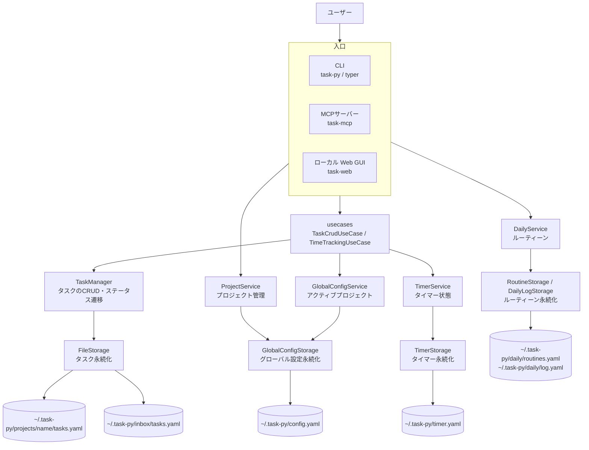
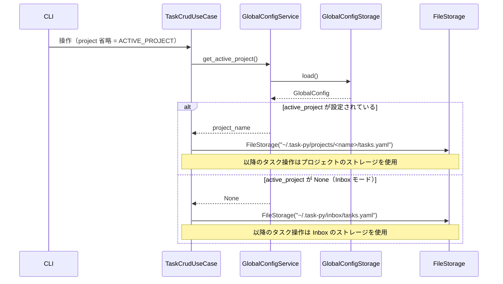
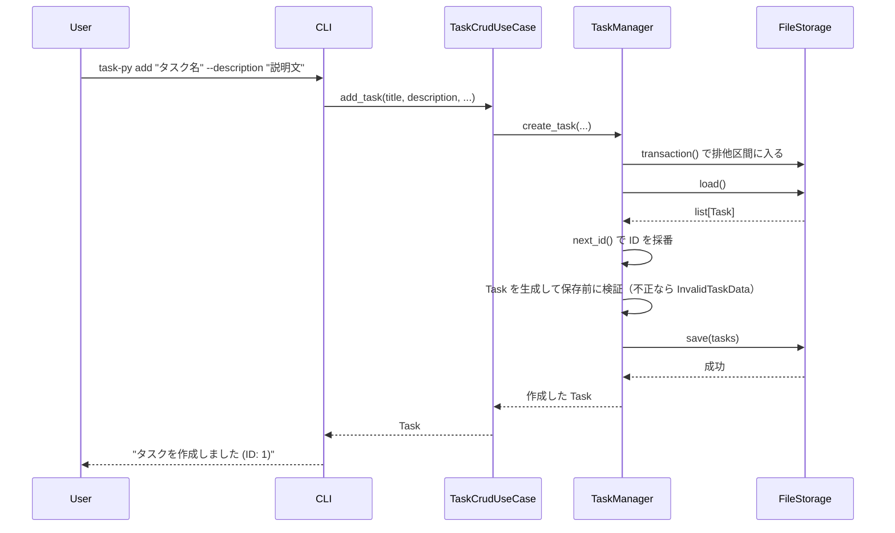
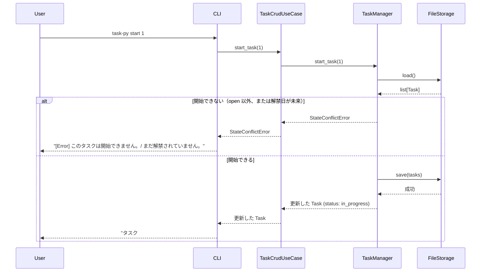
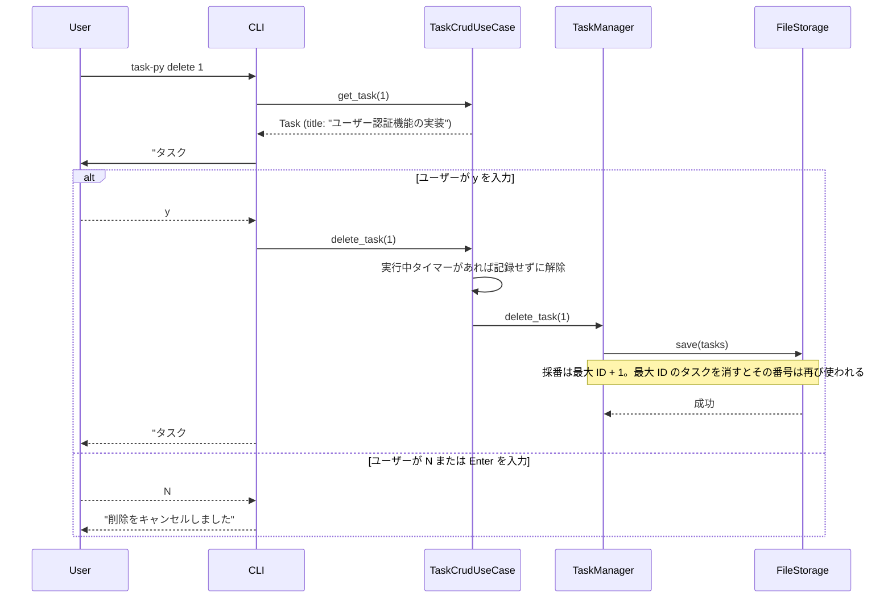
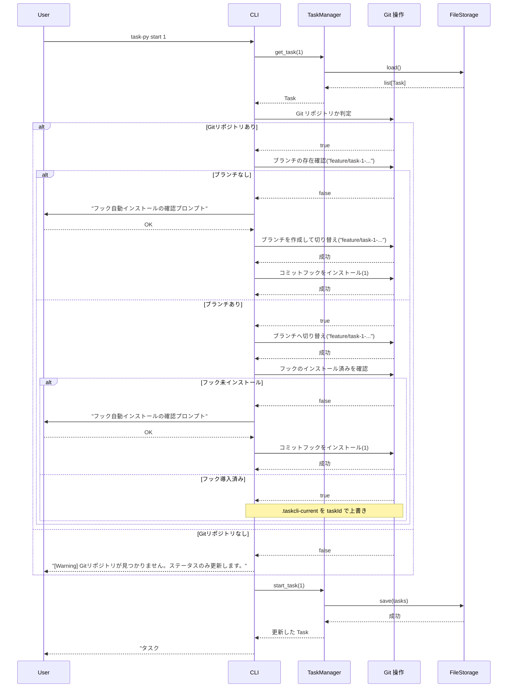
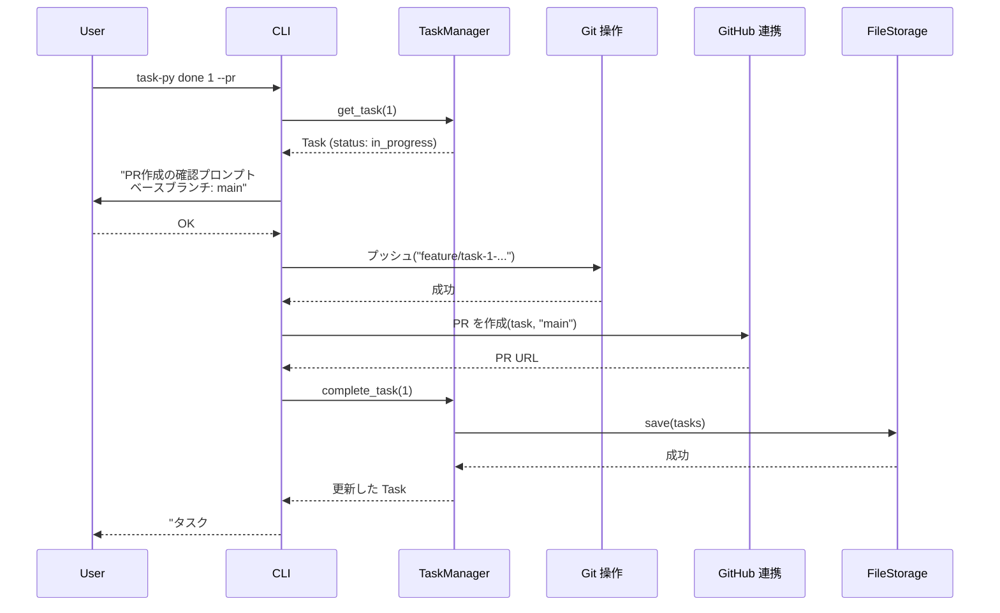
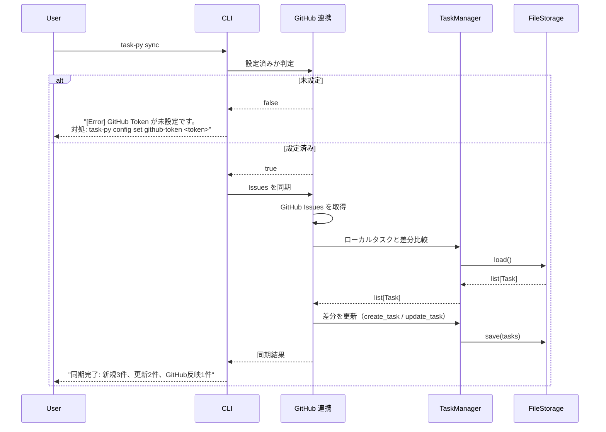

# 機能設計書 (Functional Design Document)

本書は **Python 版（`task-py`）の実装を正とする**。構造・ファイルパスは `docs/repository-structure.md`、層構造と永続化方式は `docs/architecture.md` を参照する。Git・GitHub 連携は Python 版に実装がなく、設計だけを末尾の「未実装の設計」節に残している。

## 対象バージョン

| バージョン | 対象機能 |
|-----------|---------|
| v1.0 MVP（P0） | タスク基本操作・Inbox・プロジェクト管理・ステータス管理・テーブル表示。あわせてルーティーン管理・概況表示（`overview`）・タイマーも実装済み |
| v1.1（P1） | **実装済み**: ステータスによる絞り込み・検索・タスク編集・優先度/期限管理。**未実装**: Git ブランチ自動連携・コミット自動タグ付け・GitHub Issues 連携・PR 自動作成（末尾の「未実装の設計」節） |
| v1.2 | 完了日時の記録・タイマーの永続化とタスク連携・作業時間の記録・`$EDITOR` 連携（GUI 導入の土台） |
| v1.3 | 書き込みのプロジェクト明示指定・YAML の排他制御とアトミック書き込み（GUI 導入の土台） |
| v1.4 | ローカル Web GUI の読み取り面（下記「ローカル Web GUI」節） |
| v1.5 | ローカル Web GUI の書き込み面（同節「書き込み」）と、書き込み経路の入力検証 |

※ P2 のうち**作業時間記録は v1.2 で実装済み**（下記「タイマー・作業時間」節）。解禁日（`schedule`）と MCP サーバーも実装済み。チーム機能・テンプレート・カレンダーは本設計書の対象外。

---

## システム構成図



CLI・MCP サーバー・Web GUI は同じ `~/.task-py/` を読み書きする3つの入口で、依存は外から内への一方向である（層の定義は `docs/architecture.md`）。

---

## 技術スタック

| 分類 | 技術 | 用途 |
|------|------|------|
| 言語 | Python 3.12 | |
| パッケージマネージャー | uv | 依存解決・仮想環境・`uv.lock` による再現性 |
| CLIフレームワーク | typer | コマンド解析・ヘルプ・補完 |
| データモデル | pydantic | モデル定義と保存前の検証 |
| データ保存 | pyyaml | `~/.task-py/` 以下の YAML ファイル |
| ターミナル表示 | rich | テーブル・パネル・色分け |
| インタラクティブシェル | prompt-toolkit | `task-py shell` |
| MCP | mcp[cli] | `task-mcp`（stdio） |
| Web | starlette / uvicorn / sse-starlette | `task-web`（画面は React を同梱。ビルド工程なし） |
| テスト | pytest / pytest-cov | |
| 型チェック | basedpyright | |
| リンター | ruff | |

選定の理由と代替案は `docs/architecture.md` を参照する。

---

## データモデル定義

モデルは `src/task_cli/models/` の pydantic `BaseModel`。フィールド名は snake_case で、YAML にもそのまま保存される。

### エンティティ: Task (`src/task_cli/models/task.py`)

| フィールド | 型 | 既定 | 説明 |
|---|---|---|---|
| `id` | `int` | — | ローカル ID。保存先（プロジェクトまたは Inbox）ごとに採番する。表示では複合 ID `<projectId>-<localId>`（例: `1-3`）、Inbox は `0-<localId>`（例: `0-2`）。コマンドの引数には `localId`（整数）を渡す。複合 ID（`1-3`）は表示用で、引数には渡せない |
| `title` | `str` | — | タスク名（1〜200 文字） |
| `description` | `str` | `""` | 詳細説明（Markdown 可） |
| `status` | `TaskStatus` | `open` | `open` / `in_progress` / `completed` / `archived` |
| `priority` | `Priority` | `medium` | `high` / `medium` / `low` |
| `branch` | `str \| None` | `None` | 移行データから引き継ぐ表示用の欄。Python 版は設定しない（Git 連携は未実装） |
| `due_date` | `str \| None` | `None` | 期限（`YYYY-MM-DD`） |
| `scheduled_date` | `str \| None` | `None` | 解禁日（`YYYY-MM-DD`）。この日より前は `start` できない |
| `created_at` / `updated_at` | `datetime` | 現在時刻（UTC） | 作成・最終更新日時（ISO 8601） |
| `completed_at` | `datetime \| None` | `None` | 完了日時（v1.2） |
| `work_sessions` | `list[WorkSession]` | `[]` | 作業セッションの履歴（v1.2） |

`total_worked_seconds` は `work_sessions` から計算する値で、永続化しない。

**制約**:
- `id`: 正の整数。採番は「その保存先の現在の最大 ID + 1」。最大 ID のタスクを削除すると、その番号は次の追加で再び使われる。`move` では移動先で採番し直すので ID が変わる
- `title`: 必須、1〜200 文字
- `status`: `open` → `in_progress` → `completed` の一方向遷移（`Task.can_transition_to`）。`archived` へは `open` または `completed` からのみ遷移できる（`in_progress` → `archived` は不可）。`archived` からは遷移できない
- `due_date` / `scheduled_date`: `YYYY-MM-DD` 形式。不正な日付は受け付けない（保存前に検証し、`InvalidTaskData` で断る）

### エンティティ: GlobalConfig / ProjectEntry (`src/task_cli/models/task.py`)

グローバル設定（`~/.task-py/config.yaml`）。ユーザー全体に共通する設定を管理する。

| フィールド | 型 | 説明 |
|---|---|---|
| `active_project` | `str \| None` | アクティブプロジェクト名（`None` = Inbox モード） |
| `projects` | `list[ProjectEntry]` | プロジェクト一覧。`ProjectEntry` は `name: str` と `id: int`（自動採番。Inbox は表示上 0） |
| `last_project_id` | `int` | 最後に採番したプロジェクト ID |

TypeScript 版（`~/.task/`）のデータは `task-py migrate` が変換して取り込む。Python 版の `GlobalConfigStorage.load()` は旧形式を読み替えない。

### エンティティ: Routine / DailyLog (`src/task_cli/models/daily.py`)

ルーティーン定義（`~/.task-py/daily/routines.yaml`）は、プロジェクトに依存しないグローバルな繰り返しタスク。

| フィールド | 型 | 説明 |
|---|---|---|
| `id` | `int` | 自動採番（`max(id) + 1`） |
| `title` | `str` | タイトル |
| `paused` | `bool` | 一時停止フラグ（`True` のとき `list` から非表示） |
| `created_at` | `datetime` | 作成日時 |

日別の済/未済実績（`~/.task-py/daily/log.yaml`）。直近 30 日分を保持し、古いログは保存時に削除する。

| フィールド | 型 | 説明 |
|---|---|---|
| `date` | `str` | `YYYY-MM-DD`（ローカルタイムゾーン） |
| `entries` | `list[DailyLogEntry]` | `routine_id: int` と `status: "pending" \| "done"` |

**自動作成**: ルーティーンの追加・一覧・完了などの実行時に今日のログを確かめ、無ければ（または新しいルーティーンが増えていれば）今日の分を `pending` で作る。昨日以前のログは保持する。読み取りだけの呼び出し（Web GUI）は書き足さない（`DailyService.list_today(ensure=False)`）。

### エンティティ: WorkSession / TimerState (`src/task_cli/models/time.py`)

| モデル | フィールド | 説明 |
|---|---|---|
| `WorkSession` | `started_at` / `ended_at` / `seconds` / `source` | タスクに対して実際に作業した1区間。`source` は `timer` または `manual` |
| `TimerState` | `kind` / `project` / `task_id` / `task_title` / `duration_seconds` / `started_at` / `pid` | 実行中タイマーの宣言的な記録。残り時間・経過時間は持たず、`started_at` と `duration_seconds` から都度計算する。`kind` は `countdown` または `stopwatch`（`duration_seconds` は `None`）。`task_title` は表示用のコピーで、正本はタスク側 |

`TimerFile`（`timer.yaml` のトップレベル）は `active: TimerState | None` を持つ。

### ファイル構造

```
~/.task-py/
├── config.yaml                    # グローバル設定（active_project 等）
├── inbox/
│   └── tasks.yaml                 # Inbox タスクデータ（配列）
├── projects/
│   └── <name>/
│       └── tasks.yaml             # プロジェクトのタスクデータ（配列）
├── daily/
│   ├── routines.yaml              # ルーティーン定義
│   └── log.yaml                   # 日別ログ（直近30日）
├── timer.yaml                     # 実行中タイマー（無いとき: 存在しない）
├── mcp_calls.jsonl                # MCP ツールの呼び出し記録
└── *.lock / *.bak                 # 排他用のロックファイルと、書き込み中のバックアップ
```

`project remove` は `config.yaml` の登録だけを消し、`projects/<name>/` のデータは残す。

**~/.task-py/config.yaml の例**:
```yaml
active_project: my-app
projects:
- name: my-app
  id: 1
last_project_id: 1
```

**~/.task-py/projects/my-app/tasks.yaml の例**:
```yaml
- id: 1
  title: ユーザー認証機能の実装
  description: JWT を使ったログイン・ログアウト機能
  status: in_progress
  priority: high
  branch: null
  due_date: '2026-03-31'
  created_at: '2026-02-26T10:00:00Z'
  updated_at: '2026-02-26T11:30:00Z'
  completed_at: null
  scheduled_date: '2026-03-01'
  work_sessions:
  - started_at: '2026-02-26T10:00:00Z'
    ended_at: '2026-02-26T10:25:00Z'
    seconds: 1500
    source: timer
```

**~/.task-py/daily/routines.yaml / log.yaml の例**:
```yaml
# routines.yaml
- id: 1
  title: 朝の散歩
  paused: false
  created_at: '2026-02-01T00:00:00Z'
```
```yaml
# log.yaml
- date: '2026-02-26'
  entries:
  - routine_id: 1
    status: done
```

---

## コンポーネント設計

### CLIレイヤー (`src/task_cli/cli/`)

**責務**: コマンド解析・入力バリデーション・結果の整形表示

`main.py` が typer の `app` を組み立て、コマンドは `commands/` に1コマンド1関数で置く（グループは `project.py` / `daily.py` / `time.py`）。`deps.py` が `TaskCrudUseCase` などを組み立てる。入口は `task-py`（`task_cli.cli.main:app`）、`task-mcp`、`task-web` の3つ。

**サブコマンド一覧（タスク）**:

| コマンド | 引数 / オプション | 処理概要 |
|---------|----------------|---------|
| `task-py add <title>` | `--description` / `-d`, `--priority` / `-p`, `--due` | タスク作成。優先度の既定は `medium` |
| `task-py list` | `--all-status`, `--all`, `--inbox` | タスク一覧表示。既定は `open` + `in_progress` のみ。`--all-status` で全ステータス。`--all` で全プロジェクト + Inbox。`--inbox` で Inbox のみ。優先度での絞り込みと並べ替えは CLI には無い（Web の一覧 API にはある） |
| `task-py show <id>` | — | タスク詳細表示 |
| `task-py start <id>` | — | ステータスを `in_progress` に変更。解禁日が未来のタスクは開始できない |
| `task-py done <id>` | — | ステータスを `completed` に変更し、完了日時を記録。対象タスクのタイマーは記録して停止する |
| `task-py delete <id>` | — | タスク削除（確認プロンプト付き） |
| `task-py archive <id>` | — | ステータスを `archived` に変更 |
| `task-py edit <id>` | `--title` / `-t`, `--description` / `-d`, `--priority` / `-p`, `--due`, `--due-clear`, `--scheduled`, `--scheduled-clear`, `--editor` / `-e` | タスク属性の編集（下記「`$EDITOR` 連携」を参照） |
| `task-py schedule <id> [date]` | `--clear` | 解禁日を設定・削除する。解禁日以降に `start` できる |
| `task-py search <keyword>` | — | アクティブプロジェクトまたは Inbox のタスクを、タイトル・説明の大文字小文字を区別しない部分一致で検索 |
| `task-py move <id> <project>` | — | タスクを別プロジェクト（または `inbox`）に移動。移動先で採番し直されるので ID が変わる |
| `task-py inbox` | — | アクティブプロジェクトを解除し Inbox モードに切り替え |

**プロジェクト管理**:

| コマンド | 引数 / オプション | 処理概要 |
|---------|----------------|---------|
| `task-py project create <name>` | — | プロジェクト作成（アクティブに設定される） |
| `task-py project list` | — | プロジェクト一覧表示（タスク数付き） |
| `task-py project use <name>` | — | アクティブプロジェクトを切り替え |
| `task-py project rename <old> <new>` | — | プロジェクト名を変更（ID は変わらない。データのディレクトリも移す） |
| `task-py project remove <name>` | — | プロジェクトの登録を削除（確認プロンプト付き。データのディレクトリは残る） |

**ルーティーン管理**:

| コマンド | 引数 / オプション | 処理概要 |
|---------|----------------|---------|
| `task-py daily add <title>` | — | ルーティーンを登録する |
| `task-py daily list` | `--all`（一時停止中も表示） | 今日のルーティーン一覧を表示（済は上、一時停止中は末尾） |
| `task-py daily done <id>` | — | ルーティーンを済にする |
| `task-py daily pause <id>` | — | ルーティーンを一時停止する（`list` から非表示） |
| `task-py daily resume [id]` | `--all` | 一時停止を解除する。`id` を省略するか `--all` を付けると、一時停止中の全ルーティーンを一括で再開する |
| `task-py daily delete <id>` | — | ルーティーンを削除する（実績ログも削除） |
| `task-py daily stats` | — | 最新の日別ログ7日分（ログのある日）の達成率テーブルを表示する |
| `task-py daily reset` | — | 今日のチェック状態をすべて `pending` に戻す |

**概況表示**:

| コマンド | 引数 / オプション | 処理概要 |
|---------|----------------|---------|
| `task-py overview` | — | アクティブプロジェクト・今日の毎日やること（pending）・今とりかかるべきタスク（最大3件）・全プロジェクトの `open` + `in_progress` を一画面に表示する |

**タイマー・作業時間（v1.0 でタイマー導入 / v1.2 で永続化とタスク連携）**:

| コマンド | 引数 / オプション | 処理概要 |
|---------|----------------|---------|
| `task-py time start [duration]` | `--task` / `-t`, `--detach` / `-d`, `--force` | タイマーを開始する。`duration` は `20min`/`20m`/`1h`/`30s`、または単位なし数値（分として解釈）。**省略するとストップウォッチ**。残り時間をリアルタイム表示し、終了時にターミナルベルで通知。Ctrl+C で中断した場合も経過分を記録する。`--task <id>` で作業時間の記録先を指定し、`--detach` で表示せず状態だけ記録する。実行中タイマーがあると失敗し、`--force` で置き換える（置き換えられる側は記録される） |
| `task-py time status` | — | 実行中タイマーの残り時間（または経過時間）を表示する。時間切れの場合は超過を表示する |
| `task-py time stop` | — | タイマーを終了し、経過分を対象タスクの作業時間として記録する |
| `task-py time cancel` | — | タイマーを破棄する（作業時間は記録しない） |
| `task-py time log <id> <duration>` | — | 作業時間を手動で記録する |

**タイマー状態の永続化**: 実行中タイマーは `~/.task-py/timer.yaml` に記録する。残り時間は保存された開始時刻から都度計算するため、**プロセスが落ちても・別プロセス（MCP や Web GUI）から読んでも・端末がスリープしても同じ値になる**。実行中タイマーは同時に1本のみ。

**作業時間の記録**: タスクごとの作業セッション（開始・終了・秒数）を `Task.work_sessions` として保持する。カウントダウンの場合、実績は設定時間を上限に打ち切る（タイマーの掛けっぱなしを作業時間として記録しないため）。作業時間の追記では `updated_at` を更新しない。

**タスクのライフサイクルとの連携**: `done` / `archive` は対象タスクのタイマーを記録して停止し、`delete` は記録先ごと消えるため記録せずに停止する。`move` はタイマーの向き先を移動後のタスクへ付け替える。

**完了日時（v1.2）**:

`Task.completed_at` に完了時刻を記録する。`updated_at` は編集のたびに更新されるため完了日の根拠にできないことへの対処である。アーカイブは「片付け」であって「完了の取り消し」ではないため、`completed → archived` では完了日時を保持する。移行前の完了済みタスクは値を持たないが、`updated_at` からの推測で埋めない（誤った日時を永続化すると後から真偽を区別できないため）。表示では「記録なし」とする。

**`$EDITOR` 連携（v1.2）**:

| コマンド | 引数 / オプション | 処理概要 |
|---------|----------------|---------|
| `task-py edit <id>` | （オプションなし） | 対話端末では `$EDITOR` を開き、説明を編集する。非対話端末（CI・パイプ）では従来どおりエラー終了する |
| `task-py edit <id> -e` | `--editor` | 他のオプションと併用してエディタを開く |

`VISUAL` → `EDITOR` の順に環境変数を見る。値は `shlex.split` されてから起動されるため、`EDITOR="code --wait"` のような引数付きの指定が使える。編集をキャンセルした場合・内容を元に戻した場合はどちらも「変更しない」として正常終了する。

**その他のコマンド**:

| コマンド | 引数 / オプション | 処理概要 |
|---------|----------------|---------|
| `task-py shell` | — | インタラクティブシェルを起動する（prompt-toolkit。コマンドの補完付き） |
| `task-py web` | `--port` / `-p`, `--no-open` | ローカル Web GUI を起動する（下記「ローカル Web GUI」節） |
| `task-py migrate` | `--dry-run`, `--force` | TypeScript 版（`~/.task/`）のデータを `~/.task-py/` に移行する。既存データがあれば退避してから上書きする |
| `task-py reset` | — | `~/.task-py/` のすべてのデータを削除する（削除前に退避する） |

`migrate` と `reset` の退避先は `~/.task-py.backup.<日時>`（直近 5 世代を保持）。

**MCP サーバー** (`src/task_mcp/server.py`): `task-mcp`（stdio）が、タスク・プロジェクト・ルーティーン・タイマーの操作をツールとして公開する。CLI と同じユースケース・サービスを通るので、ステータス遷移・検証・排他は CLI と同じである。

---

### TaskCrudUseCase (`src/task_cli/usecases/task_crud_usecase.py`)

**責務**: 対象プロジェクトの解決、タスク操作とタイマーの連動、複数ファイルに跨る操作の排他

```python
class TaskCrudUseCase:
    def __init__(self, global_config_service, storage_factory=None, time_tracking=None) -> None: ...
    def guarded(self, project, *also) -> Iterator[None]: ...   # 照合から書き込みまでを1つの排他区間にする
    def add_task(self, title, description="", priority=Priority.MEDIUM, due_date=None, scheduled_date=None, project=ACTIVE_PROJECT) -> Task: ...
    def list_tasks(self, filter=None, project=ACTIVE_PROJECT) -> list[Task]: ...
    def list_all_projects(self, filter=None) -> dict[str | None, list[Task]]: ...   # None が Inbox
    def list_inbox_tasks(self, filter=None) -> list[Task]: ...
    def get_task(self, id, project=ACTIVE_PROJECT) -> Task: ...
    def start_task(self, id, project=ACTIVE_PROJECT) -> Task: ...
    def complete_task(self, id, project=ACTIVE_PROJECT) -> Task: ...
    def archive_task(self, id, project=ACTIVE_PROJECT) -> Task: ...
    def delete_task(self, id, project=ACTIVE_PROJECT) -> None: ...
    def edit_task(self, id, title=None, description=None, priority=None, due_date=None, clear_due_date=False, scheduled_date=None, clear_scheduled_date=False, project=ACTIVE_PROJECT) -> Task: ...
    def set_scheduled_date(self, id, date, project=ACTIVE_PROJECT) -> Task: ...
    def search_tasks(self, keyword, project=ACTIVE_PROJECT) -> list[Task]: ...
    def search_all_projects(self, keyword) -> dict[str | None, list[Task]]: ...
    def move_task(self, id, target_project, project=ACTIVE_PROJECT) -> Task: ...
```

- 操作の対象は `project` 引数で受ける。`ACTIVE_PROJECT`（グローバルのアクティブプロジェクトに従う。CLI と MCP の既定）/ プロジェクト名 / `None`（Inbox）を型で区別する（`usecases/project_target.py`）。Web は常に明示する
- `complete_task` / `archive_task` は、遷移できる場合だけ先に実行中タイマーを記録して畳む。`delete_task` は記録せずに解除する。`move_task` は移動先で採番し直し、タイマーの向き先を付け替える
- `move_task` は移動元と移動先の両方のロックを1つの排他区間で握る（`locked` がパスをソートして取得するのでデッドロックしない）
- **ロックの取得順は `timer.yaml` → `tasks.yaml`**。逆にすると `time stop` とデッドロックする

**依存関係**: `GlobalConfigService`, `TaskManager`, `FileStorage`, `TimeTrackingUseCase`

### TimeTrackingUseCase (`src/task_cli/usecases/time_tracking_usecase.py`)

**責務**: タイマーの開始・停止・取り消しと、作業時間の手動記録。タイマーの状態（`TimerService`）と、記録先のタスク（`TaskManager`）を結ぶ

**依存関係**: `GlobalConfigService`, `TimerService`, `TaskManager`

---

### TaskManager (`src/task_cli/services/task_manager.py`)

**責務**: 1つの保存先に対するタスクの CRUD およびステータス管理。保存の前に `Task` として検証する

```python
class TaskManager:
    def __init__(self, storage: FileStorage) -> None: ...
    def create_task(self, title, description="", priority=Priority.MEDIUM, due_date=None, scheduled_date=None) -> Task: ...
    def list_tasks(self, filter: TaskFilter | None = None) -> list[Task]: ...
    def get_task(self, id: int) -> Task: ...
    def update_task(self, id: int, **kwargs) -> Task: ...
    def edit_fields(self, id, title=None, description=None, priority=None, due_date=None, ...) -> Task: ...
    def set_scheduled_date(self, id: int, date: str | None) -> Task: ...
    def append_work_session(self, id: int, session: WorkSession) -> Task: ...
    def delete_task(self, id: int) -> None: ...
    def start_task(self, id: int) -> Task: ...      # open → in_progress（解禁日が未来なら不可）
    def complete_task(self, id: int) -> Task: ...   # in_progress → completed
    def archive_task(self, id: int) -> Task: ...    # open/completed → archived
    # title・description を対象に、大文字小文字を区別しない部分一致検索
    def search_tasks(self, keyword: str) -> list[Task]: ...
    def next_id(self) -> int: ...                   # 現在の最大IDに+1した値を返す

@dataclass
class TaskFilter:
    status: TaskStatus | list[TaskStatus] | None = None  # 複数ステータス指定可
    priority: Priority | None = None
    sort: Literal["id", "priority", "due_date", "created_at"] = "id"
    # 既定は 'id' の昇順。'priority' は high > medium > low の順。
    # 'due_date' は None を末尾に置く。
```

- ステータス変更は `_apply_status_change` が唯一の絞り口で、`completed_at` の出入りをここだけで決める
- 不正な値は保存の**前**に `InvalidTaskData`（`AppError` の派生）で断る
- `TaskFilter` の `priority` / `sort` は、Web の一覧 API のクエリ（`?status=&priority=&sort=`）から使える。CLI と MCP の一覧は `status` だけを公開している

**依存関係**: `FileStorage`

---

### GlobalConfigService (`src/task_cli/services/global_config_service.py`)

**責務**: グローバル設定（`~/.task-py/config.yaml`）の読み書き・アクティブプロジェクト管理

```python
class GlobalConfigService:
    def get_active_project(self) -> str | None: ...        # None = Inbox モード
    def set_active_project(self, name: str | None) -> None: ...  # None を渡すと Inbox モード
    def get_all(self) -> GlobalConfig: ...
```

**依存関係**: `GlobalConfigStorage`

### ProjectService (`src/task_cli/services/project_service.py`)

**責務**: プロジェクトの作成・一覧・切り替え・改名・登録削除。採番とディレクトリ移動を排他区間の中で行う

```python
class ProjectService:
    def create_project(self, name: str) -> ProjectEntry: ...
    def list_projects(self) -> list[ProjectEntry]: ...
    def get_project(self, name: str) -> ProjectEntry: ...
    def use_project(self, name: str) -> None: ...
    def rename_project(self, old: str, new: str) -> None: ...  # ディレクトリを先に移し、設定を後で更新する
    def remove_project(self, name: str) -> None: ...           # 登録だけを消す。データは残る
```

**依存関係**: `GlobalConfigStorage`

### DailyService (`src/task_cli/services/daily_service.py`)

**責務**: ルーティーンの登録・今日の状態・一時停止・達成率

**依存関係**: `RoutineStorage`, `DailyLogStorage`

### TimerService (`src/task_cli/services/timer_service.py`)

**責務**: 実行中タイマーの状態の記録と、残り時間・経過時間・時間切れの計算（`started_at` から都度計算する）

**依存関係**: `TimerStorage`

---

### GlobalConfigStorage (`src/task_cli/storage/global_config_storage.py`)

**責務**: `~/.task-py/config.yaml` の読み書き

```python
class GlobalConfigStorage:
    def __init__(self, config_path: str | Path | None = None) -> None: ...
    def transaction(self) -> Iterator[None]: ...  # load→変更→save を覆う排他区間
    def load(self) -> GlobalConfig: ...
    def save(self, config: GlobalConfig) -> None: ...
    def ensure_directory(self) -> None: ...       # ~/.task-py/ を作成し 0o700 にする
```

**デフォルト値**: `active_project: None`（初回起動時は Inbox モード）

---

### FileStorage (`src/task_cli/storage/file_storage.py`)

**責務**: タスクデータ（`~/.task-py/projects/<name>/tasks.yaml` または `~/.task-py/inbox/tasks.yaml`）の読み書き・バックアップ・排他

ストレージパスはコンストラクタで受け取り、`TaskCrudUseCase` が解決した対象プロジェクトに基づいて渡す。

```python
class FileStorage:
    def __init__(self, file_path: str | Path) -> None: ...
    @property
    def path(self) -> Path: ...
    def transaction(self) -> Iterator[None]: ...  # load→変更→save を覆う排他区間
    def load(self) -> list[Task]: ...
    def save(self, tasks: list[Task]) -> None: ...
    def ensure_directory(self) -> None: ...
```

**書き込みフロー**:
1. 排他区間を取る（`tasks.yaml.lock` への `flock`）
2. 現在の `tasks.yaml` を `tasks.yaml.bak` にコピー
3. 同じディレクトリの一時ファイルへ書き、`fsync` してから `os.replace()` で差し替える
4. 親ディレクトリを `fsync` して差し替えを永続化する
5. 成功したら `.bak` を削除

読み手が観測するのは常に完全なファイルであり、書き込みが途中で失敗しても本体は変更されない。詳細は `docs/architecture.md` の「書き込み戦略」「排他制御」を参照。

### RoutineStorage / DailyLogStorage / TimerStorage (`src/task_cli/storage/`)

**責務**: `~/.task-py/daily/routines.yaml` / `~/.task-py/daily/log.yaml` / `~/.task-py/timer.yaml` の読み書き。いずれも `FileStorage` と同じく `transaction()` で排他し、書き込みは `storage/atomic.py` の `write_atomic`（一時ファイル → `fsync` → `os.replace`）を通る。`DailyLogStorage` は保存時に直近 30 日より古いログを捨てる

---

### Renderer (`src/task_cli/cli/renderer.py`)

**責務**: タスク一覧・詳細のターミナル表示

```python
def render_task_table(tasks, active_project, config, is_active=False) -> None: ...
def render_task_detail(task, active_project, config) -> None: ...
def render_success(message: str) -> None: ...
def render_info(message: str) -> None: ...     # エラーでも成功でもない通知
def render_error(error: AppError) -> None: ...
```

---

## ユースケース図

### UC-0: アクティブプロジェクト解決フロー

すべてのコマンド実行前に共通で走るフロー。タスクの保存先（プロジェクトまたは Inbox）を決定する。



MCP と Web は、`project` 引数で対象を明示できる（Web は常に明示し、グローバルのアクティブプロジェクトに依存しない）。

**ヘッダー表示ルール**（`task-py list` 実行時）:
- アクティブプロジェクトあり → `[Project: <name>]`
- Inbox モード → `[Inbox]`

---

### UC-1: task-py add（タスク作成）



---

### UC-2: task-py start（タスク開始）



`start` はタイマーを開始しない。作業時間の計測は `task-py time start --task <id>` で別に行う。

---

### UC-3: task-py delete（タスク削除）



---

## UI設計（ターミナル表示）

### task-py list のテーブル表示

`task-py list`（既定は `open` + `in_progress` のみ）は **ID / Status / Title** の3列。
```
[Project: my-app]
 ID   Status       Title
 1-1  in_progress  ユーザー認証機能の実装
 1-2  open         データエクスポート機能

[Inbox]  ← アクティブプロジェクト未設定時
 ID   Status       Title
 0-1  open         買い物リスト作成
```

**`task-py list --all`（全プロジェクト表示）**:
```
[Project: my-app]    ← アクティブプロジェクトは緑色強調
 ID   Status       Title
 1-1  in_progress  ユーザー認証機能の実装
 1-2  open         データエクスポート機能

[Project: personal]
 ID   Status       Title
 2-1  open         読書リスト

[Inbox]
 ID   Status       Title
 0-1  open         買い物リスト作成
```

**表示項目**:
| 列 | 説明 | フォーマット |
|---|---|---|
| ヘッダー行 | `[Project: <name>]` または `[Inbox]` | テーブル上部に常時表示 |
| ID | 複合 ID（`<projectId>-<localId>`、Inbox は `0-<localId>`） | 右寄せ |
| Status | ステータス | カラーコード付き文字列 |
| Title | タスク名 | 最大40文字（超過は`…`で省略） |

優先度・期限・完了日時・作業時間は、`task-py show <id>` の詳細パネルに出る（ブランチは値がある場合のみ）。解禁日は CLI の詳細パネルには出ない（Web GUI の詳細画面には出る）。

### task-py project list の表示

```
 *  my-app     5 tasks (2 in_progress)    ← * はアクティブプロジェクト
    personal   3 tasks (0 in_progress)
    [Inbox]    1 task
```

- アクティブプロジェクトは `*` と緑色で強調表示
- 各プロジェクトのタスク総数と `in_progress` 件数を表示
- Inbox のタスク数を最終行に表示
- 名前の列幅は最長のプロジェクト名に合わせて決まる（固定幅にしない）。端末が狭いときは名前を折り返す

---

### カラーコーディング

**ステータスの色分け**（`renderer.py` の `_STATUS_STYLES`）:
- `open`: 白
- `in_progress`: 黄
- `completed`: 緑
- `archived`: グレー

**優先度の色分け（`task-py show` での表示）**:
- `high`: 赤
- `medium`: 黄
- `low`: 青

---

## ローカル Web GUI（v1.4 読み取り面・v1.5 書き込み面）

`task-py web` で起動する3つ目の入口。CLI（端末）・MCP サーバー（stdio）と同じ
`~/.task-py/` を読み書きする。書き込みは**1件ずつ**で、一括操作と undo は持たない。

### 起動

```
task-py web [--port 8765] [--no-open]
```

- **127.0.0.1 にのみ待ち受ける**。`--host` は用意しない（認証を持たない面を
  ネットワークへ出せてしまうため）
- 既定でブラウザを開く。`--no-open` で抑止する
- ポートが埋まっている場合は、トレースバックではなく原因と対処を示して終了する

### 画面

| 画面 | 内容 | 対応する CLI |
|---|---|---|
| 要約 | 実行中のタイマー・今日のルーティーン・未着手のタスク | `overview` |
| すべて | 全プロジェクトと Inbox のタスクをまとめて表示。ステータス／優先度／並びで絞り込む | `list --all` |
| プロジェクト別 / Inbox | 単一の保存先のタスク | `list` / `list --inbox` |
| 詳細 | 説明・期限・解禁日・完了日時・合計作業時間・作業セッション | `show` |
| 検索 | 全プロジェクト横断 | `search`（横断に拡張） |

行からの状態変更（開始・完了・保留・片付ける。`open` の「保留」も `completed` の「片付ける」も API の `archive`）、詳細からの編集・移動・削除（確認つき）、新規追加ができる。削除は元に戻せないので、画面に確認を置く。

### JSON API（読み取り）

| エンドポイント | 内容 |
|---|---|
| `/api/state` | アクティブプロジェクト・プロジェクト一覧・リビジョン |
| `/api/overview` | 要約画面の材料 |
| `/api/tasks` | 全プロジェクト横断（`inbox` と `projects` に分けて返す） |
| `/api/inbox/tasks` / `/api/projects/{name}/tasks` | 保存先ごとの一覧 |
| `/api/inbox/tasks/{id}` / `/api/projects/{name}/tasks/{id}` | 詳細 |
| `/api/search?q=` | 全プロジェクト横断の検索 |
| `/api/events` | Server-Sent Events。他プロセスの変更を通知する |

**Inbox と名前付きプロジェクトはパスで分ける。** クエリ1つで表すと `None`（Inbox）と
「未指定」を URL 上で区別できず、`project=inbox` のような予約語方式では
`inbox` という名前のプロジェクトが作れなくなる。パスを分ければ
`/api/projects/inbox/tasks` と `/api/inbox/tasks` が別物として共存する。

エラーは CLI と同じ文面を返す: `{"error": {"message", "cause", "remedy"}}`。
「見つからない」は 404、クエリの不正は 400。書き込みの状態コードは後述の「書き込み（v1.5）」を参照。

### 書き込み（v1.5）

| 操作 | エンドポイント |
|---|---|
| 追加 | `POST /api/inbox/tasks` / `POST /api/projects/{name}/tasks` |
| 編集（解禁日を含む） | `PATCH .../tasks/{id}` |
| 開始 / 完了 / アーカイブ | `POST .../tasks/{id}/start` / `/done` / `/archive` |
| 削除 | `DELETE .../tasks/{id}` |
| 移動 | `POST .../tasks/{id}/move`（本文 `{"project": <名前> \| null}`） |

対象は**常にパスで明示**する。グローバルのアクティブプロジェクトには依存しない。

**リクエスト本文**（JSON）:

| 操作 | 本文 |
|---|---|
| 追加 | `title`（必須）、`description` / `priority` / `due_date` / `scheduled_date`（任意） |
| 編集 | 変えたい項目だけ。**キーが無ければ変更しない**。`due_date` / `scheduled_date` は `null` で消す |
| 移動 | `{"project": <名前> \| null}`（`null` は Inbox） |
| 開始・完了・アーカイブ・削除 | 本文は空でよい |

**`Content-Type: application/json` は本文の無い `POST` / `DELETE` にも必須**。付けないと 415。

**応答**: 追加は 201、それ以外は 200。本文は `{"project": ..., "task": ...}`。削除は `{"deleted": {"project": ..., "id": ...}}`。

**移動の挙動**: 移動先で採番し直されるので **ID が変わる**。応答の `project` は移動先になる。
移動先が現在地と同じなら何もせず、現状のタスクを 200 で返す（採番し直すと、開いている詳細画面が 404 になる）。
移動元と移動先の両方を1つの排他区間で握る。

**競合の検出**: 既存のタスクを変える操作は、画面が見ていた `updated_at` を **`If-Match` ヘッダ**に載せて送る。
サーバは保存の直前（同じ排他区間の内側）に現在の値と照合する。

| 状況 | 応答 |
|---|---|
| 一致 | 実行して更新後のタスクを返す |
| 食い違い | **409**。本文に現在のタスクを添える（画面が最新を出し直せる） |
| `If-Match` が無い、または `*` | **428**。「省略したら上書き」にはしない |

- 弱い検証子（`W/"..."`）も受ける。外さないとプロキシが付け替えただけで毎回 409 になる
- **作業セッションの追記（タイマーの停止）では 409 にならない**。作業時間の記録はタスクの内容の編集ではなく、`updated_at` を動かさない
- 画面は 409 を専用の見せ方で出す（赤いエラーとは別。**(a)(b) の両方が対象**で、`current` があれば「現在の内容」も出す）。**入力中の内容は捨てず**、比べる基準の版だけを最新に差し替えて再保存できる。再保存では**利用者が実際に触った項目だけ**を送る。全項目を送ると、別の場所で変わった項目まで古い値で書き戻してしまう

**状態コード**: 404 は「対象が無い」だけに使う。

| コード | 意味 |
|---|---|
| 400 | 値が不正（日付形式・空のタイトル・不正な優先度・空にできない項目への `null` など） |
| 403 | 別のサイトからの書き込み |
| 404 | タスク・プロジェクトが無い（移動先の未登録を含む） |
| 409 | 2種類ある。**(a) 版の食い違い**（本文に現在のタスク `current` を添える）／**(b) いまの状態ではできない**（開始・完了・アーカイブできない、まだ解禁されていない。`current` は付かない） |
| 415 | `Content-Type` が JSON でない |
| 428 | `If-Match` が無い |

**`null` の意味**: `due_date` / `scheduled_date` は `null` で「消す」。タイトル・説明・優先度は必ず値を持つので `null` は 400 で断る。黙って既定値に読み替えると、`high` のタスクが静かに `medium` に降格する。

### 書き込み経路の入力検証

保存の**前**に `Task` として検証する（`TaskManager`）。CLI・MCP・Web の3入口で同じ。
不正な値は `InvalidTaskData` になり、message / cause / remedy の3要素で、どの項目が何を期待するかを日本語で示す
（例: 期限に `bogus` → cause「期限に 'bogus' が指定されました。」、remedy「YYYY-MM-DD の形式で指定してください（例: 2026-12-31）。」）。
Web では 400。

- **保存前に弾く**。保存後に気づいても、以後 `load()` が落ちてそのプロジェクトのタスクが全部読めなくなる
- `move` は移動先プロジェクトの実在を、ディレクトリを作る**前**に確かめる。存在しない名前は `NotFoundError`（404）
- 経緯（なぜこうなったか）は `.steering/20260920-web-write-surface/` を参照

### 他プロセスの変更の反映

`~/.task-py/` 配下の監視対象ファイル（`config.yaml` / 各 `tasks.yaml` / `timer.yaml` /
`daily/*.yaml`）の mtime とサイズからリビジョン値を作り、変わったら SSE で通知する。
**差分は送らない**。クライアントは通知を受けて表示中のものを取り直す。

サーバーは**1秒間隔**でリビジョンを再計算し、前回と違った回だけ送る。したがって
他プロセスの変更は最大で1秒程度の遅れで画面に届く。接続直後にも現在の値を1度送る
（`EventSource` は切断時に自動再接続するため、その間の変更を取りこぼさない）。

### 画面の実装方針

- React と htm の UMD ビルドを**リポジトリに同梱**し、実行時に CDN を読まない。
  オフラインでも壊れず、起動のたびに外部へ通信することもない
- **ビルド工程を持たない**。node / npm を使わず、JSX の代わりに htm の
  タグ付きテンプレートリテラルを使う
- 静的ファイルは `Cache-Control: no-cache` で配信する。付けないと、利用者が
  task-py を更新してもブラウザが古い JavaScript を実行し続ける

---

## エラーハンドリング

### エラークラス設計

`src/task_cli/exceptions.py` の `AppError` を基底とし、message・cause・remedy の3要素を持つ。

```python
class AppError(Exception):
    def __init__(self, message: str, cause: str, remedy: str) -> None: ...

class NotFoundError(AppError): ...       # 対象（タスク・プロジェクト）が存在しない。Web では 404
class StateConflictError(AppError): ...  # いまの状態ではその操作ができない。Web では 409
```

`InvalidTaskData`（`src/task_cli/services/task_manager.py`）は保存前の検証で値が不正なときの `AppError` の派生で、Web では 400。どれにも当たらない素の `AppError` は Web で 500 になる。CLI と MCP は従来どおり `except AppError` で扱う。

### エラー表示フォーマット

`render_error`（`src/task_cli/cli/renderer.py`）が次の形で出し、終了コード 1 で終わる。

```
[Error] <エラーの概要>
  原因: <なぜ失敗したか>
  対処: <ユーザーが取るべき操作>
```

### エラー種別一覧

| エラー種別 | 処理 | 表示例 |
|-----------|------|-------|
| 入力バリデーション（`InvalidTaskData`） | 保存せずに処理を中断 | `[Error] 期限の値が正しくありません。\n  原因: 期限に 'bogus' が指定されました。\n  対処: YYYY-MM-DD の形式で指定してください（例: 2026-12-31）。` |
| タスクが見つからない（`NotFoundError`） | 処理を中断 | `[Error] タスクが見つかりません。\n  原因: ID=99 のタスクは存在しません。\n  対処: task list で有効なIDを確認してください。` |
| 不正なステータス遷移（`StateConflictError`） | 処理を中断 | `[Error] このタスクは開始できません。\n  原因: archived のタスクは in_progress に変更できません。\n  対処: タスクのステータスを確認してください。` |
| 解禁日前の開始（`StateConflictError`） | 処理を中断 | `[Error] このタスクはまだ解禁されていません。\n  原因: scheduled_date (2026-12-01) が未来のため着手できません。\n  対処: 解禁日 (2026-12-01) 以降に start を実行してください。` |
| プロジェクト名の重複・移動先の未登録 | 処理を中断 | `[Error] 同名のプロジェクトが既に存在します。` ほか。移動先が未登録なら `NotFoundError` |
| 保存先ファイルが存在しない | 空データとして扱い継続（警告は出さない） | — |
| 保存先ファイルの読み込み失敗（YAML が壊れている等） | **未対応**。例外がそのまま表示される。`.bak` が残っていれば手で戻す | トレースバック |
| ファイル書き込み失敗 | 一時ファイルを破棄し、本体は無変更のまま例外を伝える（`.bak` からの復元経路も残す） | 例外（ディスク容量・権限など） |

---

## パフォーマンス設計

- **YAMLファイルの全件読み込み**: 1 コマンド実行あたり、対象ストレージの `load()` を必要最小限にとどめる。更新系は排他区間の中で `load()` → 変更 → `save()` を1回で行う
- **検索**: リスト内包表記と文字列の `in` 判定で十分（`TaskManager.search_tasks`。最大 10,000 件でも数ミリ秒以内）
- **バックアップ**: `tasks.yaml` の書き込み時のみ `.bak` を作成し、完了後即削除。常時 2 ファイル以上保持しない
- **排他とfsync**: 単一ストレージを操作するコマンドではロック取得1回・`fsync` 2回（本体と親ディレクトリ）。`move` と `time stop` は複数ファイルに跨るため複数回になる。実測で従来比 +0.35ms（中央値 7.18ms → 7.53ms）であり、ローカル操作 100ms 以内の要件に影響しない

---

## セキュリティ設計

- **`~/.task-py/` のパーミッション**: 各ストレージの `ensure_directory()`（`GlobalConfigStorage` / `FileStorage` / `RoutineStorage` / `DailyLogStorage` / `TimerStorage`）が `os.chmod(<ディレクトリ>, 0o700)` を設定し、オーナーのみアクセス可能にする。排他用のロックファイルは `0o600` で作る
- **Web GUI の面**: 127.0.0.1 にのみ待ち受け、Host 検証と書き込みの出自検査（CSRF）を持つ。詳細は「ローカル Web GUI」節を参照
- **未実装の機能の安全上の考慮**（GitHub トークンの保管・コマンドインジェクション防止など）は、「未実装の設計」節にまとめている

---

## テスト戦略

テストは pytest で、`tests/` に置く。

### ユニットテスト

- `TaskManager` と `TaskCrudUseCase`（`tests/test_usecases.py`）: 各メソッドの正常系・異常系（ステータス遷移違反、ID不存在、保存前の検証など）
- モデル（`tests/test_models.py`）: 制約・ステータス遷移・日付形式
- ストレージ（`tests/test_storage.py` / `tests/test_atomic.py`）: バックアップ・アトミック書き込み・排他
- `ProjectService`（`tests/test_project_service.py`）・`DailyService`（`tests/test_daily_service.py`）・`TimerService`（`tests/test_timer_service.py`）
- 表示ロジック（`tests/test_project_list.py` ほか）: 長い名前の整列・色分けなど

### 統合テスト

- ユースケース層の一連のフロー（追加・開始・完了・アーカイブ・移動・削除。実際のファイル I/O を使用。`tests/test_usecases.py` / `tests/test_time_tracking_usecase.py`）
- 同時実行の排他（`tests/test_concurrency.py`）
- Web API の読み書き・競合検出（`tests/test_web_api.py` / `tests/test_web_write.py`）、MCP サーバー（`tests/test_mcp_server.py`）
- `migrate` と `reset` のバックアップ世代（`tests/test_cli_reset.py` / `tests/test_backup.py`）

### 文書の現行性

- `tests/procedures/test_functional_design_currency.py` が、本書が TypeScript 版時代の記述に戻らないこと・書かれたパスとコマンドが実在することを検査する

### E2Eテスト（手動）

- 実機で `task-py` を一時的な `HOME` で起動し、`add` → `start` → `done`、`reset` の複数回実行、`project list` の長い名前の表示を確認する

---

## 未実装の設計（Git・GitHub 連携 P1）

> **この節の機能は Python 版には未実装である。** `src/` に Git・GitHub を扱う処理はなく（`Task.branch` は移行データから引き継ぐ表示用の欄にすぎない）、`task-py` に `config` / `sync` / `import` コマンドも、`start` のブランチ作成も、`done --pr` もない。
>
> ここにあるのは、`docs/product-requirements.md` の P1 要求（Git ブランチ連携・コミット自動タグ付け・GitHub Issues 連携・PR 自動作成）に対する**設計案**で、TypeScript 版の時代に書かれたものである。設計の意図を残すために言語に依存しない形で書き直してあり、**実装するときは** Python 版の層構造（`docs/architecture.md`）とストレージ（YAML）に合わせて読み替える。実装済みの機能と取り違えないこと。
>
> Git・GitHub 連携のほか、それと合わせて検討されていた一覧表示の拡張案（優先度・期限の列。下記「一覧表示の追加列」）も含む。優先度と期限の列は Git と無関係だが、CLI の一覧には未実装である。

### 追加で必要になるサブコマンド

| コマンド | 引数 / オプション | 処理概要 |
|---------|----------------|---------|
| `task-py start <id>` | — | ステータス変更に加えて Git ブランチを作成し、コミットフックをインストールする |
| `task-py done <id>` | `--pr` | ステータス変更。`--pr` を付けるとプッシュして PR を作成する |
| `task-py config setup` | — | 対話式ウィザードで GitHub Token・Owner・Repo を一括設定する |
| `task-py config set <key> <value>` | — | プロジェクト別設定値を個別に保存する（GitHub Token 等） |
| `task-py sync` | — | GitHub Issues と双方向同期する |
| `task-py import --github` | — | GitHub Issues からローカルにインポートする |

### Git 操作（ブランチ・コミットフック）

**責務**: Git ブランチ操作とコミットフックの管理。Git 操作は専用ライブラリの API を通し、シェルコマンドの文字列結合は行わない。

| 操作 | 説明 |
|---|---|
| Git リポジトリか判定 | カレントディレクトリが Git リポジトリかどうか |
| 現在のブランチを取得 | |
| ブランチの存在確認 | |
| ブランチを作成して切り替え / 既存ブランチへ切り替え | `task-py start` から使う |
| コミットメッセージフックのインストール | `prepare-commit-msg` を置く（下記） |
| プッシュ | `task-py done --pr` から使う |
| ブランチ名の生成 | タスク ID とタイトルから生成する（下記） |

**ブランチ命名規則**:
- フォーマット: `feature/task-<id>-<slug>`
- スラッグ変換: タイトルを小文字英数字+ハイフンに変換。非 ASCII 文字（日本語等）は除去。連続するハイフンは 1 つに圧縮。先頭・末尾のハイフンも除去
- 最大長: 63文字（超過時は切り詰め）
- スラッグが空になる場合（タイトルが全角文字のみ等）は `task-<id>` のみとする

**スラッグ変換例**:

| 入力タイトル | 変換後スラッグ |
|-----------|-------------|
| `"ユーザー認証機能の実装"` | `""` → ブランチ名: `feature/task-1` |
| `"Fix: Login Bug #123"` | `"fix-login-bug-123"` |
| `"Add OAuth 2.0 Support"` | `"add-oauth-2-0-support"` |
| `"user authentication"` | `"user-authentication"` |

**コミットフック仕様** (`.git/hooks/prepare-commit-msg`):
```sh
#!/bin/sh
# TaskCLI: auto-append task number
TASK_ID=$(cat "$(git rev-parse --show-toplevel)/.taskcli-current" 2>/dev/null)
if [ -n "$TASK_ID" ]; then
  echo "" >> "$1"
  echo "[Task #$TASK_ID]" >> "$1"
fi
```
- `task-py start <id>` 実行時に Git リポジトリルートの `.taskcli-current` にタスクIDを保存する
- `task-py done <id>` 実行時に `.taskcli-current` を削除する
- `.taskcli-current` は `.gitignore` に追加する（追記前に確認プロンプトを出す）

### GitHub 連携（Issues 同期・PR 作成）

**責務**: GitHub Issues の同期・PR 作成

| 操作 | 説明 |
|---|---|
| PR を作成 | タスクとベースブランチを受け取り、PR の URL を返す |
| Issues を同期 | 結果は `created`（ローカルに新規作成したタスク数）・`updated`（更新したタスク数）・`pushed`（GitHub Issues に反映したタスク数） |
| Issues をインポート | GitHub Issues からタスクを作る |
| 設定済みか判定 | Token・Owner・Repo が揃っているか |

**PR 本文テンプレート**:
```markdown
## 概要
{task.description が空でなければ記載。空の場合は「{task.title} の実装」}

## 関連タスク
Task #{task.id}
```

**依存関係**: プロジェクト別設定、HTTP クライアント（標準ライブラリで足りる）

### プロジェクト別設定

プロジェクト別設定は、Python 版の層構造に合わせて `~/.task-py/projects/<name>/config.yaml` に保存する（`docs/architecture.md` の機密情報の記述と一致）。保存時にファイルパーミッションを `600` に設定する。

| 項目 | 型 | 説明 |
|---|---|---|
| `github_token` | `str \| None` | GitHub Personal Access Token |
| `github_owner` | `str \| None` | GitHub リポジトリのオーナー名 |
| `github_repo` | `str \| None` | GitHub リポジトリ名 |
| `default_branch` | `str` | デフォルトのベースブランチ（既定 `main`） |

**バリデーション仕様**:

| キー | バリデーション |
|-----|-------------|
| `github_token` | `ghp_` または `github_pat_` で始まる文字列。形式が不正な場合は警告を表示して保存（API エラーは sync / PR 作成時に検出） |
| `github_owner` | 英数字・ハイフンのみ（GitHub ユーザー名規則）。空文字は不可 |
| `github_repo` | 英数字・ハイフン・アンダースコア・ドットのみ。空文字は不可 |
| `default_branch` | 空文字は不可。デフォルト値: `main` |

コマンドで指定するキーはハイフン区切り（`github-token`）、保存される項目名は snake_case（`github_token`）とする。

**設定ファイルの例**:
```yaml
github_token: null
github_owner: null
github_repo: null
default_branch: main
```

### 一覧表示の追加列

P0 の一覧（ID / Status / Title）に、次の列を足す案。

```
[Project: my-app]
 ID   Status       Priority  Title                            Branch                              Due
 1-1  in_progress  high      ユーザー認証機能の実装            feature/task-1-user-authentication  2026-03-31
 1-2  open         medium    データエクスポート機能             -                                   -
 1-3  completed    low       初期セットアップ                   feature/task-3-initial-setup        -
```

| 列 | 説明 | フォーマット |
|---|---|---|
| Priority | 優先度 | カラーコード付き文字列 |
| Branch | ブランチ名（Git 連携を実装した場合のみ意味を持つ。`Task.branch` は現状、移行データの表示用） | 最大35文字（超過は`…`で省略）、なければ `-` |
| Due | 期限 | `YYYY-MM-DD`、なければ `-`、期限切れは赤 |

**期限の色分け**: 期限切れ（今日以前）は赤、残り 3 日以内は黄、それ以外はデフォルト色。

### ユースケース

以下の図で `CLI` が `TaskManager` を直接呼んでいるのは TypeScript 版の名残である。実装するときは、実装済みのユースケース図（UC-0〜UC-3）と同じく `CLI → TaskCrudUseCase → TaskManager` の経路にする。

#### task-py start（Git ブランチ作成 + コミットフックインストール）

Inbox のタスクに `task-py start` を実行した場合は、ステータスだけを `in_progress` に更新し、「プロジェクトに移動してから Git 連携を使用してください」という情報メッセージを表示する。



#### task-py done --pr（タスク完了 + PR作成）



#### task-py sync（GitHub Issues 同期）



### エラー

| エラー種別 | 処理 | 表示例 |
|-----------|------|-------|
| Gitリポジトリなし | ブランチ操作をスキップ、警告表示 | `[Warning] Gitリポジトリが見つかりません。ステータスのみ更新します。` |
| Gitブランチ操作失敗 | 元のブランチに戻す、処理を中断 | `[Error] ブランチの作成に失敗しました。\n  原因: <git エラーメッセージ>\n  対処: git status を確認し、未コミットの変更を解消してください。` |
| GitHub Token 未設定 | 処理を中断 | `[Error] GitHub Token が未設定です。\n  原因: GitHub 連携機能には設定が必要です。\n  対処: task-py config set github-token <token> で設定してください。` |
| GitHub API エラー | 処理を中断 | `[Error] GitHub API リクエストが失敗しました。\n  原因: <HTTPステータスコード> <メッセージ>\n  対処: Token の権限と有効期限を確認してください。` |
| ネットワークタイムアウト | 処理を中断 | `[Error] ネットワークタイムアウト（5秒）が発生しました。\n  原因: GitHub API に接続できません。\n  対処: インターネット接続を確認してください。` |
| Inbox タスクへの `task-py start` | ステータスのみ更新、情報メッセージ表示 | `[Info] タスク #1 を開始しました。Git 連携を使用する場合は task-py move 1 <project> でプロジェクトに移動してください。` |

### 性能と安全上の考慮

- **タイムアウト**: GitHub API 呼び出しには 5 秒のタイムアウトを設定する
- **設定ファイルのパーミッション**: 保存後に `600` を設定し、オーナーのみ読み書きできるようにする（Token を格納するため）
- **`.taskcli-current` の `.gitignore` 追加**: `task-py start` 実行時に Git リポジトリルートの `.gitignore` へ追記するか、確認プロンプトを表示する
- **コマンドインジェクション防止**: Git 操作は専用ライブラリの API を使い、シェルコマンドの文字列結合を行わない。GitHub API リクエストのパラメータは URL エンコードしてから組み立てる

### テスト観点

- ブランチ名の生成: スラッグ変換ロジック（日本語のみのタイトル・連続ハイフン・最大長）
- Git リポジトリありの環境で `task-py start` → ブランチ自動作成を確認する
- Git リポジトリなしの環境で `task-py start` → 警告表示のみでクラッシュしないことを確認する
- `task-py done --pr` での PR 作成（テスト用 GitHub リポジトリを使用）
